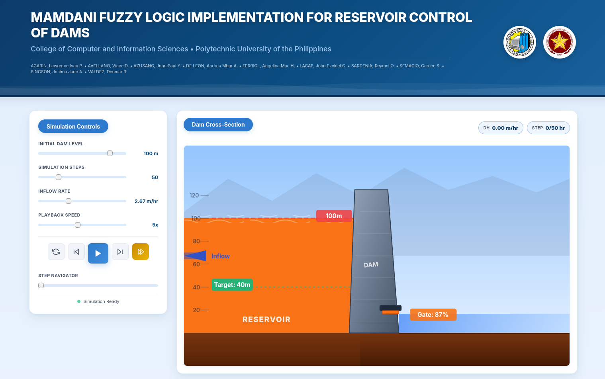
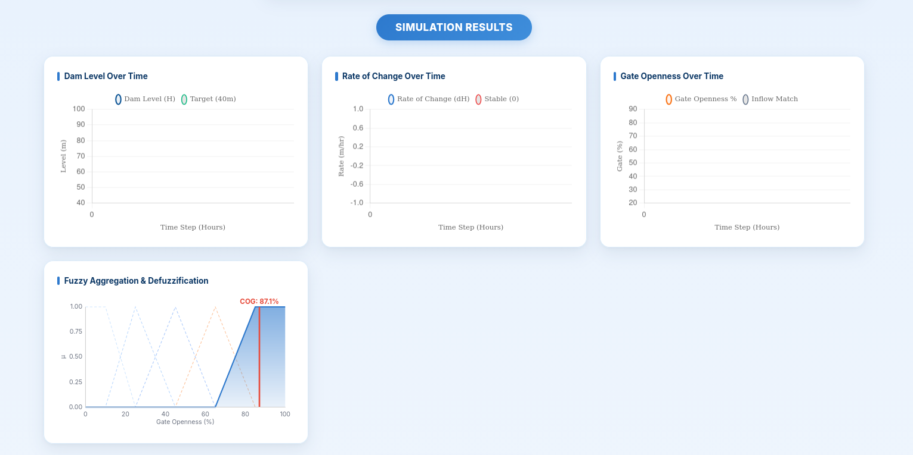
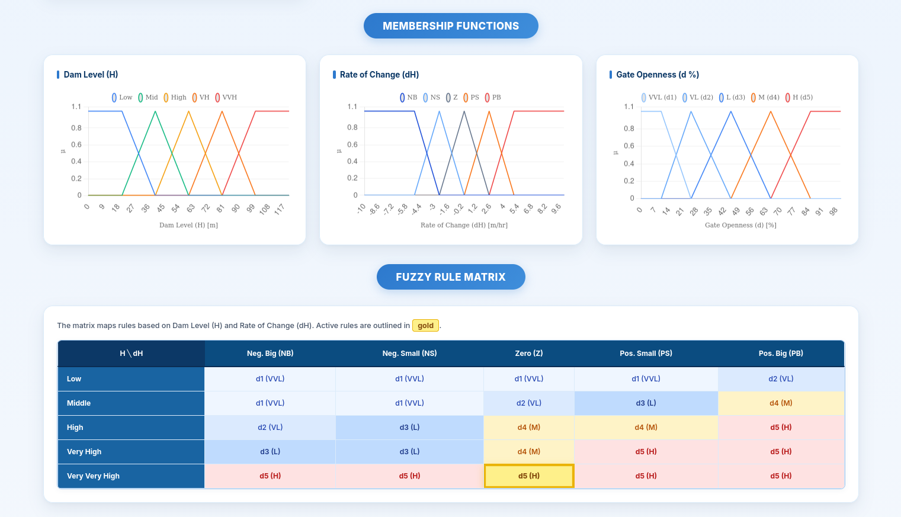

# Mamdani Fuzzy Logic Dam Controller

An interactive browser-based simulation of a Mamdani fuzzy logic controller for reservoir and dam-gate control.

## Run the simulation

From the project directory, start a local web server:

```bash
python3 -m http.server 8000
```

Then open [http://localhost:8000/app/](http://localhost:8000/app/) in a browser.

The simulation uses Chart.js from a CDN, so an internet connection is needed when the page loads.

## Project structure

```text
DAM/
├── app/
│   ├── index.html       # Simulation interface
│   ├── app.js           # Fuzzy controller and simulation logic
│   └── style.css        # Interface styling
├── assets/
│   ├── branding/        # CCIS and PUP logos
│   └── screenshots/      # Project and interface screenshots
├── notebooks/
│   └── DAM_control.ipynb # Supporting fuzzy-logic exploration
└── README.md
```

## Screenshots

### Dam cross-section and simulation controls



### Simulation results



### Membership functions and fuzzy rule matrix



## Main controls

- Initial dam level
- Number of simulation steps
- Inflow rate
- Playback speed
- Step-by-step navigation or full simulation playback

